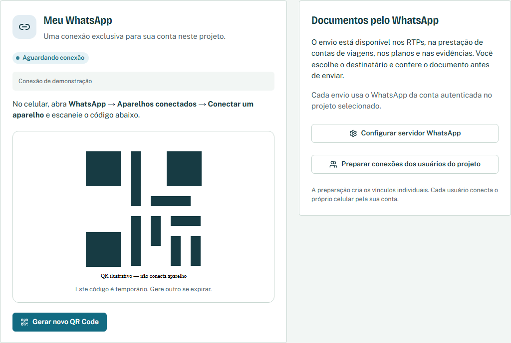
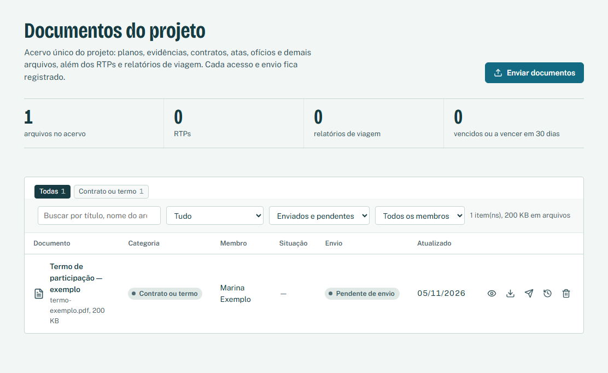
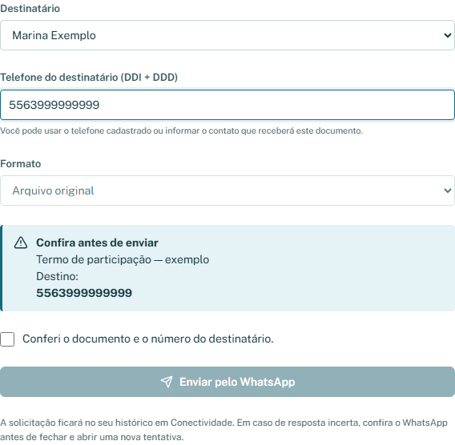
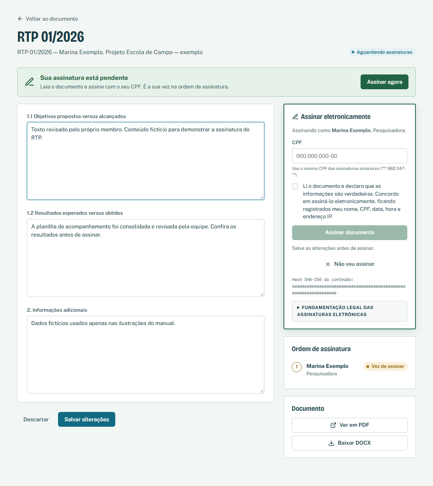
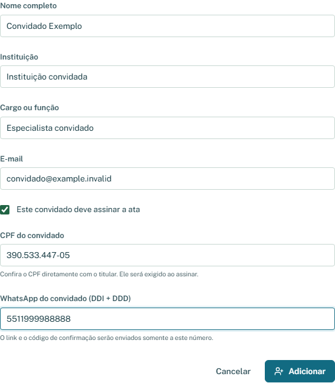
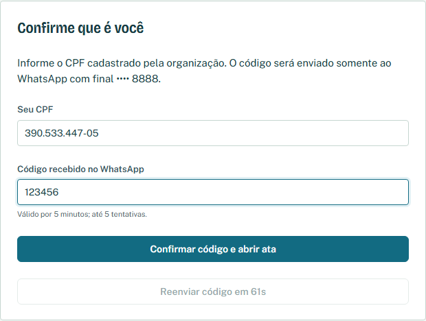
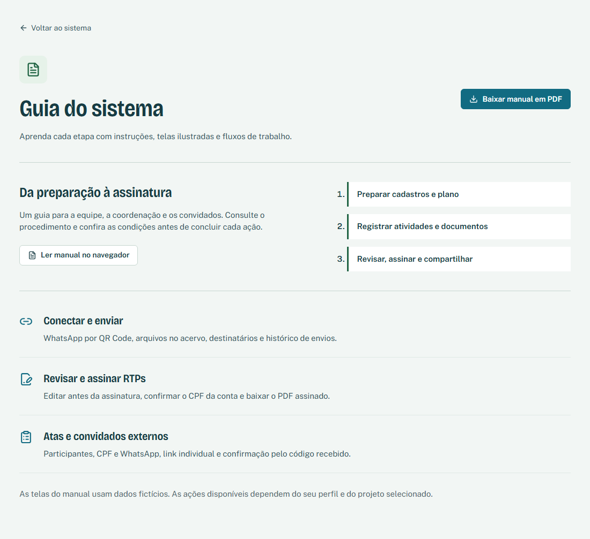

# Manual do usuário

Guia passo a passo dos módulos do sistema

Projetos • Bolsistas • Planos de Trabalho • Execução • RTP • Diárias e passagens • Documentos • Assinaturas • Atas • WhatsApp

## Comece pelo que você precisa fazer

Conectar um número de WhatsApp: página 6.

Adicionar um arquivo ao sistema: página 8.

Enviar um documento pelo WhatsApp: página 7.

Gerar e aprovar um RTP: páginas 15 a 17.

Assinar um documento: página 21.

Criar uma ata e colher assinaturas: páginas 22 a 24.

## Sobre esta edição

Edição ilustrada 1.1 • 05 de novembro de 2026

Manual elaborado a partir dos módulos, telas e regras presentes no código do RTP Inteligente nesta data. Inclui telas da aplicação com dados fictícios e diagramas dos principais fluxos. Nenhum telefone, senha ou documento real é necessário para acompanhar as instruções.

> Os menus e as ações disponíveis dependem do seu perfil, do projeto selecionado e dos módulos liberados pela administração. Use o endereço do sistema fornecido pela sua instituição.

<!-- page -->
# Sumário

Clique em um item para ir à página correspondente. O PDF também possui marcadores de navegação.

[sumario]

<!-- page -->
# 01. Entenda o fluxo do sistema

O RTP Inteligente organiza o trabalho do projeto e seus documentos. O planejamento, os registros do que aconteceu e os relatórios são etapas relacionadas, com funções diferentes.

## Caminho de um RTP

1. Cadastrar ou conferir os dados do projeto e do bolsista.

2. Importar o Plano de Trabalho e conferir os itens extraídos.

3. Registrar as atividades executadas, os resultados e as evidências.

4. Escolher o período e gerar o RTP individual de cada bolsista.

5. Revisar o texto, resolver os achados de validação e aprovar.

6. Solicitar assinaturas, acompanhar a conclusão e baixar o arquivo assinado.

## Outros caminhos de uso

Viagens: escolher o beneficiário, preencher o Formulário 26, anexar fotos, concluir e solicitar assinaturas.

Atas: registrar a reunião e os participantes, revisar, finalizar e encaminhar para assinatura.

Documentos: reunir arquivos no acervo, organizar categorias e versões, baixar ou enviar pelo WhatsApp.

> Um plano descreve o que se pretende fazer. Um registro de execução descreve o que aconteceu. Confira os resultados antes de aprovar qualquer relatório.

<!-- page -->
# 02. Acesso e primeiro uso

## Entrar pela primeira vez

1. Abra o endereço do sistema informado pela coordenação.

2. Na tela Entrar, digite o e-mail cadastrado e a senha temporária recebida individualmente. Clique em Entrar.

3. Se aparecer Crie sua senha definitiva, informe a senha temporária, a nova senha e a confirmação.

4. A nova senha deve ter pelo menos 12 caracteres, com maiúscula, minúscula, número e símbolo.

5. Clique em Trocar senha e continuar. Nos próximos acessos, use a senha definitiva.

## Instalar como aplicativo

1. Use Instalar aplicativo na entrada ou no menu lateral.

2. Siga o procedimento exibido para o seu navegador e dispositivo. Quando disponível, confirme a instalação no aviso do navegador.

3. Abra pelo ícone instalado e entre normalmente. O sistema precisa de internet para consultar e alterar dados.

## Quando o acesso não funciona

E-mail ou senha incorretos: confira o endereço, as maiúsculas e os espaços. Muitas tentativas: aguarde o tempo indicado antes de tentar outra vez.

Sua conta ainda não tem acesso a um projeto: encaminhe à administração o e-mail e o identificador exibidos para que ela confira o vínculo.

> A senha temporária aparece uma única vez para quem cria a conta. Solicite orientação à administração se não a recebeu. Ao terminar em um dispositivo compartilhado, use Sair.

<!-- page -->
# 03. Perfis, menus e projeto em foco

## O que cada perfil costuma acessar

Administração: gerencia usuários e configurações, além dos módulos operacionais.

Coordenação: prepara cadastros e planos, acompanha a execução, gera e revisa relatórios e conduz os fluxos documentais do projeto.

Bolsista: trabalha com a própria execução, relatórios, viagens, documentos e assinaturas conforme o vínculo da conta.

Somente assinatura: acessa os documentos enviados para sua assinatura. Pode receber módulos adicionais liberados para um projeto.

## Navegar no dia a dia

1. No computador, use o menu lateral. No celular, toque no botão de menu para abrir as opções.

2. Se houver mais de um projeto disponível, confira o campo Projeto em foco e selecione o correto antes de cadastrar, consultar ou enviar.

3. Em Visão geral, acompanhe o ciclo dos bolsistas, os indicadores e as pendências. Use as buscas e os filtros das telas para localizar registros.

4. Abra o sino de notificações para consultar os avisos e os documentos relacionados.

## Módulos adicionais

A administração pode liberar Atas de Reunião e Conexão WhatsApp por pessoa e projeto. O módulo Envio das atas pelo WhatsApp define um responsável de envio para o projeto e depende dos outros dois.

> Se uma opção não aparece, confira o projeto selecionado e peça à administração que verifique seu perfil e os módulos. Cadastrar um bolsista e criar sua conta de acesso são ações distintas.

<!-- page -->
# 04. Conectar seu WhatsApp

## Antes de começar

Tenha acesso à sua conta, ao projeto correto e ao celular com o WhatsApp que será usado nos envios. A coordenação precisa ter disponibilizado o servidor de conexão.

## Conectar um número pelo QR Code

1. Abra Compartilhar > Conectividade no menu. Em Meu WhatsApp, confira o estado da conexão.

2. Clique em Conectar meu WhatsApp. Aguarde a preparação e a exibição do QR Code.

3. No celular, abra WhatsApp > Aparelhos conectados > Conectar um aparelho. A localização dessa opção pode variar conforme o aparelho.

4. Leia o QR Code exibido no sistema usando o recurso de pareamento do WhatsApp. Se necessário, abra o sistema em outro dispositivo para conseguir escanear a tela.

5. Mantenha a tela aberta e aguarde Conectado. A tela consulta o estado periodicamente; você também pode usar Atualizar estado.

6. Se o código expirar, clique em Gerar novo QR Code e repita a leitura. O QR exibido é temporário e é retirado da tela após cerca de um minuto.

## Qual número faz o envio?

Nos envios comuns, o sistema usa a conexão da conta autenticada dentro do projeto selecionado. Outro usuário precisa entrar na própria conta e conectar o próprio aparelho.

> Cadastrar um telefone em Bolsistas não conecta esse WhatsApp. O cadastro identifica um contato; o QR Code autoriza a conexão de envio da conta no projeto.

<!-- page -->
# 05. Enviar pelo WhatsApp

## Enviar um RTP, uma viagem ou um arquivo

1. Abra o documento na tela de origem ou localize-o em Documentos. Se houver alterações no editor, salve antes de enviar.

2. Clique em Enviar documento ou no ícone de envio da linha correspondente. Na dúvida, passe o mouse sobre o ícone para ler sua identificação.

3. No painel Enviar documento, escolha um Destinatário cadastrado ou Informar outro número.

4. Confira Telefone do destinatário (DDI + DDD). Para um número brasileiro, informe 55, DDD e telefone. Exemplo ilustrativo: 5563999999999. Não use apenas o número local.

5. Escolha Formato: DOCX editável ou PDF para os relatórios. Arquivos do acervo são enviados no formato original.

6. Leia o quadro Confira antes de enviar. Verifique o título, o número de destino e a versão salva. Um RTP ainda não aprovado segue como prévia.

7. Marque Conferi o documento e o número do destinatário. Clique em Enviar pelo WhatsApp e aguarde a resposta.

8. Abra Conectividade > Meus envios recentes e confira o registro. Verifique no WhatsApp se o documento chegou ao contato correto.

## Como interpretar o resultado

Aceito pelo servidor: a solicitação foi aceita para envio; isso ainda não comprova entrega ou leitura no celular. Enviando: há processamento em andamento. Conferir no WhatsApp ou resposta incerta: confira a conversa antes de iniciar outra tentativa.

> Se o botão estiver desabilitado, confira a conexão, o telefone, a marca de confirmação e as alterações não salvas. O fluxo de solicitar assinaturas é explicado na página 20.

<!-- page -->
# 06. Adicionar arquivos ao acervo

O botão Enviar documentos da tela Documentos adiciona arquivos ao armazenamento do projeto. Para encaminhar um arquivo a um contato, use depois Enviar documento, conforme a página 7.

## Fazer o upload

1. Abra Compartilhar > Documentos. Confira o projeto e clique em Enviar documentos.

2. Arraste os arquivos para a área indicada ou clique para escolher no dispositivo. O painel aceita até 20 arquivos por vez e até 50 MB por arquivo.

3. Para cada arquivo, confira o Título e escolha a Categoria: contrato ou termo, ata, ofício, nota fiscal, certidão, produto técnico, relatório, evidência ou outra categoria disponível.

4. Informe Validade quando fizer sentido, como em certidões ou contratos. A data é opcional.

5. Se seu perfil permitir, selecione o Membro relacionado ou Documento do projeto (sem membro). Inclua uma Descrição para facilitar a localização.

6. Em lotes, use Aplicar a todos quando a categoria ou o membro forem comuns. Confira cada item antes de prosseguir.

7. Clique em Enviar arquivo(s). Aguarde Enviado e registrado. Se um arquivo falhar, leia a mensagem e use Tentar novamente para concluir os pendentes.

## Formatos e origem dos documentos

O seletor aceita PDF, documentos de escritório, imagens e formatos como CSV, TXT e ZIP, conforme a lista da tela. Se um arquivo for recusado, confira o tipo, o tamanho e a mensagem exibida.

> Planos de Trabalho devem ser importados pelo módulo próprio. Planos importados, evidências, RTPs e relatórios de viagem também aparecem no acervo conforme seus fluxos.

<!-- page -->
# 07. Consultar, atualizar e baixar arquivos

## Localizar e abrir

1. Entre em Documentos e use a busca e os filtros disponíveis para encontrar o arquivo, membro ou categoria.

2. Clique em Visualizar para abrir o arquivo ou Baixar para salvar uma cópia no dispositivo. Alguns formatos dependem de um aplicativo compatível para leitura.

3. Clique no título ou em Detalhes, versões e histórico para consultar os metadados, as versões, os envios e o histórico de ações.

## Atualizar o arquivo

1. Nos detalhes, clique em Nova versão quando a ação estiver disponível.

2. Escolha o arquivo substituto e confirme Enviar nova versão. As versões anteriores ficam guardadas e podem ser consultadas na lista Versões.

3. Para alterar apenas título, categoria, validade, membro ou descrição, edite os campos permitidos e clique em Salvar dados.

4. Para atualizar um Plano de Trabalho, importe a nova versão em Planos de Trabalho. O acervo direciona esse procedimento ao módulo de origem.

## Alertas e exclusão

A validade destaca documentos vencidos e os que vencem em até 30 dias. Renove o documento e envie uma nova versão quando necessário.

A indicação Nova versão pendente de envio avisa que um RTP foi atualizado depois do envio registrado. Confira a versão atual antes de encaminhar novamente.

> Excluir documento exige informar o motivo. A ação pode abranger as versões do arquivo e permanece na auditoria. Para corrigir um arquivo mantendo a evolução documental, use Nova versão.

<!-- page -->
# 08. Cadastrar e conferir projetos

Os dados institucionais do projeto alimentam os formulários. Confira-os antes de gerar relatórios para evitar corrigir vários documentos depois.

## Criar um projeto

1. Com um perfil autorizado, abra Preparar > Projetos e clique em Cadastrar projeto.

2. Preencha o Título completo do projeto e a Instituição executora.

3. Informe Projeto/convênio (formulários FAPTO), quando houver. Esse campo identifica o convênio no Formulário 26; se estiver vazio, o sistema usa o título do projeto.

4. Confira Fundação de apoio, Coordenação geral e Município de emissão.

5. Informe as datas de Início e Encerramento. O encerramento deve ser igual ou posterior ao início.

6. Escolha a Situação e preencha Descrição e Objetivo geral conforme os dados institucionais.

7. Clique em Cadastrar projeto e confira o cartão criado.

## Editar ou selecionar

1. No cartão do projeto, clique em Editar para ajustar os campos. Use Salvar alterações ao terminar.

2. Para trabalhar naquele projeto, clique em Colocar em foco ou selecione-o em Projeto em foco no menu.

3. Confira a seleção antes de cadastrar bolsistas, importar planos ou conectar o WhatsApp.

> Alterar um cadastro não substitui a revisão de relatórios já emitidos. Abra o documento e confira o resultado antes de reaproveitá-lo ou enviá-lo.

<!-- page -->
# 09. Cadastrar bolsistas e contatos

## Criar o cadastro do membro

1. Abra Preparar > Bolsistas e clique em Cadastrar bolsista.

2. Digite Nome completo exatamente como aparece no Plano de Trabalho. A importação em lote usa esse nome para reconhecer a pessoa.

3. Preencha Função ou área de atuação e Modalidade da bolsa.

4. Informe Telefone / WhatsApp com DDI e DDD. Confira também o E-mail: ele será importante para o acesso e a identificação nos fluxos de assinatura.

5. Informe Vigência inicial e Vigência final. A data final não pode ser anterior à inicial.

6. Escolha Situação da bolsa: Ativa, Suspensa ou Encerrada. Preencha Observações administrativas se necessário.

7. Clique em Cadastrar bolsista. Use a busca por nome ou área para localizar o registro.

## Acompanhar a ficha individual

Clique no nome do bolsista para abrir sua ficha e consultar os dados e o andamento do ciclo de trabalho. Use as ações de edição disponíveis para corrigir informações antes de gerar documentos.

Se o nome não for reconhecido na importação do plano, confira a grafia no cadastro e o texto do arquivo. Evite criar cadastros duplicados para a mesma pessoa.

> O cadastro do bolsista não cria automaticamente uma senha. A administração cria a conta e associa o acesso à pessoa e ao projeto; veja a página 25.

<!-- page -->
# 10. Importar Planos de Trabalho

## Preparar os arquivos

Cadastre os bolsistas antes de importar. Use PDF ou DOCX com texto selecionável, até 20 MB por arquivo e 30 arquivos por envio. Se o PDF for apenas uma digitalização, obtenha uma versão com texto reconhecido antes da importação.

## Importar um ou vários planos

1. Abra Preparar > Planos de Trabalho.

2. Arraste os arquivos para a área de importação ou clique para selecioná-los.

3. Em A quem pertence cada plano, escolha Identificar pelo nome no documento para associar cada arquivo ao bolsista cujo nome completo aparece no texto.

4. Use Todos para um bolsista quando os arquivos pertencerem à mesma pessoa ou o plano não trouxer o nome completo. Confira o bolsista escolhido.

5. Acione a importação e aguarde o resultado de cada arquivo. Verifique o bolsista reconhecido, os itens e o cronograma extraídos.

6. Para arquivos sem correspondência, confira o nome ou selecione explicitamente o bolsista e repita a importação.

7. Clique em Conferir para revisar o conteúdo de cada plano importado.

## Quando há uma atualização

Uma nova importação cria outra versão do plano e mantém a anterior no histórico. Confira a nova versão antes de utilizá-la nos próximos relatórios.

> Plano extraído ainda fica a conferir. A leitura automática pode omitir ou classificar incorretamente itens; a conferência humana faz parte do fluxo.

<!-- page -->
# 11. Conferir plano e cronograma

## Revisar o conteúdo extraído

1. Abra Conferir no resultado da importação ou na indicação Aguardando conferência.

2. Compare os itens com o documento original. Confira a Responsabilidade do bolsista no projeto e ajuste o texto quando necessário.

3. Em Itens extraídos, confira o Tipo e o Texto extraído de cada item. Diferencie objetivos, atividades e resultados conforme as opções da tela.

4. Se algum conteúdo relevante não tiver sido extraído, use Incluir item que a leitura não encontrou e preencha-o fielmente ao plano.

5. No Cronograma de atividades individualizado, marque os meses previstos para cada atividade.

6. Use Salvar rascunho se precisar interromper a conferência. Ao concluir, clique em Confirmar plano ou Confirmar novamente. É necessário classificar ao menos um objetivo individual e uma atividade prevista.

7. Volte à listagem e confira se o plano deixou de estar pendente de conferência.

## Como o cronograma afeta o relatório

Os meses selecionados ajudam a identificar quais atividades estavam previstas no período do RTP. Sem meses definidos, a atividade é tratada como prevista em qualquer período.

Uma classificação ou data incorreta pode gerar lacunas e cobranças de execução que não correspondem ao planejamento real. Corrija o plano antes de gerar o relatório.

> Alterações no plano valem para os próximos RTPs. Relatórios já gerados mantêm suas próprias versões e precisam ser revisados no editor.

<!-- page -->
# 12. Registrar execução e evidências

## Registrar o que aconteceu

1. Abra Acompanhar > Execução das atividades. Se a tela oferecer seleção de bolsista, escolha a pessoa correta.

2. Clique em Registrar execução.

3. Preencha o Período de referência: Início e Fim. Esse recorte determina em quais períodos de RTP o registro poderá ser considerado.

4. Em Atividade prevista no plano, selecione a atividade correspondente. Se não houver vínculo aplicável, use a opção Sem vínculo com atividade prevista.

5. Descreva a Atividade executada com fatos verificáveis: o que foi realizado, onde, com quem e qual foi a entrega.

6. Informe Execução iniciada em, Execução encerrada em e Situação conforme o andamento real.

7. Preencha Produto gerado, Resultado observado, Dificuldades encontradas, Providências adotadas e Observações quando houver informação pertinente.

8. Na área Evidência, escolha o arquivo e informe a Descrição da evidência. Use planilhas, atas, notas técnicas ou produtos que comprovem a atividade.

9. Salve o registro pela ação do formulário e confira sua presença na listagem. Verifique as datas antes de gerar o RTP.

## Exemplo ilustrativo

Atividade prevista: elaborar levantamento de campo. Execução: visitas realizadas em três localidades no período informado. Produto: planilha consolidada. Resultado: base de dados revisada. Evidência: planilha e registro da atividade.

> Sem registros, o RTP apresenta as atividades do plano como pendentes de confirmação. Registrar uma atividade como planejada não comprova sua execução.

<!-- page -->
# 13. Gerar RTP individual ou em lote

## Preparar e conferir

1. Abra Relatar > Gerar RTP com um perfil de gestão.

2. Informe Período inicial, Período final e Data de emissão. Use o recorte que precisa ser relatado.

3. Confira a informação de Numeração do RTP. A numeração é automática e única no projeto; números de RTPs excluídos não são reutilizados.

4. Escolha Extensão do texto: Sintético, Padrão institucional ou Detalhado.

5. Selecione um ou mais Bolsistas. Use Selecionar ativos para facilitar a seleção ou Limpar para refazê-la.

6. Clique em Conferir dados de bolsista(s). Consulte Dados disponíveis, a origem das informações, as pendências e o cronograma com o período destacado.

7. Se houver erro no cadastro, plano ou período, volte e corrija antes de iniciar a geração.

## Processar e abrir os resultados

1. Clique em Gerar relatório preliminar ou Gerar relatórios preliminares, conforme a quantidade selecionada.

2. Acompanhe Processamento: cada pessoa possui seu próprio resultado. Não feche a tela enquanto estiver acompanhando o lote.

3. Se houver falha, leia o detalhe e use Repetir com falha. Evite gerar novamente os relatórios que já foram concluídos.

4. Clique em Revisar ao lado do resultado ou em Ver todos os relatórios para abrir a listagem.

> Gerar um relatório produz uma versão para revisão. A aprovação depende da conferência humana e do tratamento das validações.

<!-- page -->
# 14. Revisar o RTP e tratar pendências

## Conferir a versão gerada

1. Abra Relatórios e selecione o RTP pelo bolsista, número e período.

2. Na aba Documento, confira a identificação do projeto, a vigência, a numeração e todas as seções do Formulário 9.

3. Compare o texto com o plano, os registros e as evidências. Corrija afirmações imprecisas e clique em Salvar versão.

4. Se houver lacunas, abra o tratamento disponível para o item. Registre a execução, indique que está em andamento, reprogramada ou excluída com justificativa, conforme a realidade e as opções oferecidas.

5. Use Regenerar seção para refazer um trecho a partir dos dados disponíveis. Salve primeiro: a regeneração parte da última versão salva e pode descartar alterações pendentes. Confira o resultado antes de prosseguir.

## Resolver os achados de validação

1. Abra a aba Validação ou clique em Ver achados.

2. Leia cada achado e identifique se a origem é o cadastro, o período, o planejamento, a execução ou o texto.

3. Corrija a origem quando necessário. Se o achado puder ser encerrado com justificativa, use a ação de resolução, registre a explicação e clique em Marcar como resolvido.

4. Confira os achados restantes antes de solicitar aprovação. Achados críticos abertos bloqueiam a aprovação.

> Uma justificativa deve explicar a situação e apoiar a decisão de quem revisa. Não encerre um achado apenas para liberar o botão de aprovação.

<!-- page -->
# 15. Aprovar, exportar e versionar RTP

## Concluir a revisão

1. Salve as alterações. A tela avisa quando há Alterações não salvas.

2. Use Enviar para revisão quando o documento precisar da conferência responsável.

3. Com permissão de gestão, confira as validações e clique em Aprovar RTP. A aprovação bloqueia a edição.

4. Se precisar corrigir um RTP aprovado, use Reabrir para edição. Essa ação retira a aprovação; revise e aprove novamente depois.

## Baixar e enviar

No painel Exportar, escolha PDF ou DOCX. Antes da aprovação, os arquivos servem como prévia. Para colher assinaturas, use o painel Assinatura eletrônica, descrito na página 20.

Para enviar a versão salva pelo WhatsApp, use Enviar documento. Quando precisar da cópia final assinada, baixe pelo painel de assinatura ou localize o PDF correspondente no acervo, conferindo título e versão.

## Consultar e recuperar versões

1. Abra a aba Versões. Cada salvamento, regeneração ou restauração cria uma versão nova.

2. Clique em Comparar com a atual para conferir diferenças antes de decidir recuperar um conteúdo.

3. Use Restaurar na versão desejada quando necessário. A restauração cria outra versão e mantém o histórico anterior.

> Um documento com assinatura registrada tem restrições adicionais de edição. Se for preciso alterá-lo, a coordenação deve conduzir o cancelamento das assinaturas e uma nova coleta, conforme os avisos da tela.

<!-- page -->
# 16. Diárias e passagens

## Iniciar o Formulário 26

1. Abra Prestação de contas > Diárias e passagens.

2. Clique em Iniciar relatório de prestação de contas.

3. Selecione o Membro do projeto. Confira nome, função, telefone e e-mail do beneficiário.

4. Confirme a criação e abra o Relatório de viagem.

5. Confira a Identificação do beneficiário. Esses dados vêm do cadastro do bolsista; para corrigi-los, ajuste o cadastro de origem.

## Preencher e salvar

1. Preencha Cidade/UF de origem, Cidade/UF de destino, Saída e Retorno. Data do pagamento da diária é opcional.

2. Em Objetivo e resultados, descreva o propósito e os resultados da viagem. Em Atividades por data, use Um dia por linha após informar saída e retorno, ou Linha para adicionar registros. Preencha a data e a atividade de cada linha.

3. Inclua as informações necessárias para identificar o deslocamento e os resultados alcançados. Confira a coerência das datas.

4. Clique em Salvar e aguarde a confirmação antes de sair, exportar ou enviar. O aviso Alterações não salvas indica conteúdo ainda pendente de gravação.

## Formulário em branco

Na tela de Diárias e passagens, a seção Formulário em branco permite selecionar o beneficiário e baixar DOCX ou PDF com a identificação preenchida e os dados da viagem em branco, para preenchimento manual.

> Se não aparecer um beneficiário, peça à coordenação para conferir o cadastro do membro e a associação da sua conta a ele.

<!-- page -->
# 17. Fotos e conclusão da viagem

## Reunir os registros

1. Abra o relatório da viagem correta.

2. Em Registro fotográfico, adicione imagens do evento e dos comprovantes de deslocamento. Preencha Legenda, se necessário, e saia do campo para gravá-la. Use as setas para ajustar a ordem.

3. Confira cada imagem, a ordem e sua relação com a viagem. As fotos são gravadas separadamente dos campos do formulário; confirme o resultado de cada operação.

4. Guarde os demais comprovantes de deslocamento no acervo Documentos, identificando o membro e a viagem na descrição.

## Concluir e encaminhar

1. Revise o objetivo, o período, os registros e as fotos. Clique em Salvar se houver alterações.

2. Clique em Concluir para passar o relatório de Em preenchimento para Concluído.

3. No painel Documento, baixe DOCX editável ou PDF, ou use Enviar documento para encaminhar pelo WhatsApp.

4. No painel Assinatura eletrônica, use Solicitar assinaturas para iniciar a coleta. Acompanhe os participantes e baixe o PDF assinado ao final.

5. Se precisar corrigir um relatório concluído, peça à coordenação para usar Reabrir. Quando houver assinatura, siga o procedimento de cancelamento e nova coleta informado na tela.

> O sistema exibe lembretes para anexar comprovantes e entregar a prestação em até 15 dias corridos após o retorno. Confira com a coordenação os procedimentos e prazos aplicáveis à sua viagem.

<!-- page -->
# 18. Solicitar assinaturas em RTP e viagem

## Preparar os participantes

O membro e a coordenação precisam ter contas e contatos corretos no sistema. A pessoa responsável pela solicitação deve conferir sua conexão WhatsApp antes dos avisos automáticos.

1. Abra o RTP ou o Relatório de viagem. Revise e salve todas as alterações.

2. No painel Assinatura eletrônica, clique em Solicitar assinaturas.

3. Confira 1º — Membro da equipe e 2º — Coordenação do projeto. Escolha pessoas diferentes. Se necessário, use Adicionar signatário; o painel admite até quatro posições.

4. Se o membro não tiver conta, peça à administração para criar um acesso Somente assinatura. Quando disponível para a administração, use Criar acesso de assinatura e encaminhe a senha temporária individualmente.

5. Clique em Criar e enviar pelo WhatsApp. O sistema cria a solicitação, envia ao 1º signatário o PDF e o link pelo seu WhatsApp conectado e mostra se a mensagem saiu (ou o motivo, se não saiu). Antes de assinar, o signatário pode corrigir ou completar o relatório em "Alterar ou inserir informações". Se preferir enviar por outro meio, use Só copiar o link.

6. Acompanhe a Ordem de assinatura. O membro assina primeiro; a próxima pessoa recebe a vez após a anterior. Os avisos automáticos acompanham a evolução da solicitação.

7. Se necessário, use Copiar link de assinatura ou Enviar link pelo WhatsApp. Confira a situação antes de repetir um envio.

8. Quando a coleta estiver concluída, use Baixar PDF assinado ou DOCX com assinaturas. Uma cópia PDF também é salva em Documentos, na categoria Relatório.

> Com assinatura registrada, o conteúdo fica bloqueado. Para corrigir, a coordenação usa Cancelar solicitação ou Cancelar assinaturas para alterar, informa o motivo e conduz uma nova coleta após a revisão.

<!-- page -->
# 19. Assinar e verificar um documento

## Passo a passo do signatário

1. Abra o link recebido ou entre em Minhas assinaturas e selecione o documento.

2. Se solicitado, entre com o e-mail cadastrado. No primeiro acesso, troque a senha temporária antes de continuar.

3. Leia o documento completo e confira nome, período, informações e anexos exibidos. Verifique se é o documento esperado.

4. Se aparecer Aguardando a sua vez, aguarde o signatário anterior. Nas atas, os participantes podem assinar em qualquer ordem.

5. Quando sua assinatura estiver disponível, informe o CPF confirmado pela administração para sua própria conta. Um CPF diferente é bloqueado, inclusive no primeiro uso. Se o cadastro estiver pendente, peça a conferência em Configurações.

6. Marque a declaração de leitura e concordância. Clique em Assinar documento e aguarde Assinatura registrada.

7. Se houver informação incorreta, solicite a correção. Quando permitido, use Alterar ou inserir informações e salve antes de assinar. Para recusar, use Não vou assinar e informe o motivo.

## Verificar autenticidade

1. Abra o QR Code ou o endereço de verificação presente no arquivo. Também é possível usar Ver comprovante de verificação quando disponível.

2. Confira os dados, o código e a situação exibida na página pública. Documentos substituídos ou cancelados devem ser avaliados conforme essa indicação.

3. Para encaminhar uma cópia final, use o PDF assinado associado à solicitação concluída.

> O sistema registra nome, CPF, data, hora, IP e informações de integridade na assinatura. O link de assinatura exige acesso à conta; a página de verificação permite conferir o documento pelo código.

<!-- page -->
# 20. Criar e redigir Atas de Reunião

## Identificar a reunião

1. Abra Acompanhar > Atas de Reunião e clique em Nova ata.

2. Preencha Assunto e Título do documento.

3. Informe Data, horário de Início e de Encerramento, e Modalidade: On-line, Presencial ou Híbrida.

4. Preencha a Plataforma de videoconferência ou o Local, conforme a modalidade.

5. Informe Responsável pela reunião, Responsável pela elaboração, Objetivo da reunião e Cidade da assinatura.

## Redigir o conteúdo

1. Inclua os participantes conforme a página seguinte. A abertura automática utiliza dados da reunião e dos presentes.

2. Confira Abertura. Se precisar de texto específico, use Editar manualmente. Revise também o texto de encerramento.

3. Use Adicionar tópico para criar os pontos de pauta. Registre as discussões, decisões e encaminhamentos nos campos do editor. Ordene os tópicos conforme a reunião.

4. Inclua imagens, anexos e informações de próxima reunião quando forem pertinentes. Confira endereço, contatos e rodapé institucional.

5. Use Salvar e Pré-visualizar para conferir o documento. O editor tenta salvar automaticamente após cerca de dois segundos sem alterações; confirme Tudo salvo ou o horário de salvamento antes de sair.

> Somente quem criou a ata ou a gestão autorizada pode editá-la. Finalizar ata congela a versão; faça a conferência antes dessa ação.

<!-- page -->
# 21. Participantes e responsável das atas

## Definir quem participou e quem assina

1. Na ata em edição, abra Participantes.

2. Selecione as pessoas cadastradas e use Incluir. Quando apropriado, use Incluir todos e revise a lista para evitar participantes indevidos.

3. Confira Pessoa, Instituição e Cargo ou função. Defina a Situação de presença de cada participante.

4. Marque Assina para os participantes que devem assinar. A ação Presentes assinam facilita a seleção, mas a lista deve ser conferida.

5. Para alguém sem conta, use Adicionar convidado externo. Preencha nome, instituição, cargo, e-mail, CPF e WhatsApp com DDI e DDD. Marque Este convidado deve assinar a ata. Confira os dados com o titular antes de adicionar.

6. Salve a ata. Confira se há pelo menos um signatário marcado antes de finalizar e encaminhar.

## Definir de qual WhatsApp saem as atas

1. A administração abre Configurações > Editar acesso para a pessoa responsável.

2. No projeto correto, habilita Atas de Reunião, Conexão WhatsApp e Envio das atas pelo WhatsApp, conforme as opções do painel.

3. Clique em Salvar acesso. O responsável entra na própria conta e conecta o WhatsApp em Conectividade para esse projeto.

4. Antes de encaminhar a ata, a equipe confere o responsável e a conexão. Há um responsável de envio das atas por projeto.

> Membros assinam pelo próprio login. Convidados externos recebem link individual e confirmam CPF e código pelo WhatsApp, sem criar conta. Um CPF já vinculado a uma conta deve seguir o fluxo interno.

<!-- page -->
# 22. Finalizar e colher assinaturas da ata

## Emitir e encaminhar

1. Confira identificação, presença, signatários, tópicos e anexos. Use Pré-visualizar e revise o PDF.

2. Clique em Finalizar ata e confirme o aviso. O sistema emite uma versão com informações de integridade e código de verificação.

3. Clique em Encaminhar para assinatura. Confira a mensagem de criação da solicitação e eventuais falhas nos avisos.

4. Acompanhe Controle de assinaturas. Os participantes assinam em qualquer ordem; o progresso mostra quantos concluíram.

5. Use Copiar link de assinatura ou Abrir página de assinatura quando necessário. O signatário segue o procedimento da página 21.

6. Após a conclusão, confira PDF com as assinaturas e Baixar PDF. Uma cópia é salva em Documentos, na categoria Ata. Confira os avisos de compartilhamento pelo WhatsApp do responsável.

## Corrigir ou encerrar o ciclo

Reabrir edição: permite corrigir o conteúdo mediante a confirmação da tela. A versão emitida anterior passa a constar como substituída e a nova versão precisa seguir novamente o fluxo de emissão e assinatura.

Arquivar e Desarquivar: organizam o ciclo da ata conforme as ações disponíveis. Cancelar ata registra o encerramento e o motivo. Confira o impacto informado antes de confirmar.

Excluir ata: pode apagar os arquivos e manter apenas a auditoria. Para atas com assinaturas, a exclusão é restrita à administração, exige motivo e altera a verificação pública para documento cancelado.

> As atas usam assinatura em paralelo. RTPs e relatórios de viagem usam uma ordem de assinatura. Confira sempre o estado exibido no documento específico.

<!-- page -->
# 23. Administração de usuários e módulos

## Criar uma conta

1. Entre com perfil de administração e abra Configurações.

2. Em Usuários da aplicação, clique em Cadastrar usuário.

3. Informe Nome completo, E-mail e Perfil. Selecione o Projeto e, quando exigido, o Bolsista associado.

4. Para um acesso Somente assinatura, associe o membro correspondente ou a opção de signatário externo disponível. Confira nome e e-mail antes de salvar.

5. Conclua o cadastro e copie a credencial exibida. A senha temporária aparece uma única vez; envie-a diretamente à pessoa por um canal individual.

6. Oriente o usuário a criar a senha definitiva. Antes de assinar, abra Editar acesso, confira CPF confirmado e WhatsApp com o titular e informe o motivo da conferência. Salve o acesso. Para a própria conta administrativa, use Confirmar meu CPF.

## Ajustar permissões

1. Localize a pessoa na listagem e clique em Editar acesso.

2. Confira o perfil, o vínculo ao projeto e os módulos liberados. Habilite Atas de Reunião e Conexão WhatsApp quando necessários.

3. Para o responsável de envio de atas, confira também Envio das atas pelo WhatsApp e suas dependências. Clique em Salvar acesso e peça à pessoa que confira o acesso.

4. Para encerrar um acesso, use Revogar e confirme o aviso. Para reativar uma conta revogada, use Restaurar quando apropriado.

> Revogar acesso preserva o histórico institucional. Evite criar outra conta para resolver um vínculo incorreto: confira o acesso existente e o e-mail antes de cadastrar novamente.

<!-- page -->
# 24. Configurar o servidor WhatsApp

Esta etapa é destinada à gestão autorizada. O usuário comum conecta o celular pelo QR Code, depois que o servidor está disponível.

## Disponibilizar a integração no projeto

1. Obtenha com o responsável técnico o endereço do servidor Evolution e a chave administrativa correspondente.

2. Abra o projeto correto e entre em Conectividade.

3. Clique em Configurar servidor WhatsApp.

4. Preencha Endereço do servidor Evolution e Chave administrativa. Use os dados reais fornecidos pelo responsável; o endereço ilustrativo do campo é apenas um exemplo.

5. Clique em Validar e salvar configuração. Aguarde a confirmação de que o servidor foi validado e a configuração protegida foi salva para o projeto.

6. Se necessário, use Preparar conexões dos usuários do projeto. Confira quantas conexões foram preparadas e repita para concluir as pendentes, se a tela indicar falhas.

7. Oriente cada pessoa a entrar na própria conta e seguir a conexão por QR Code da página 6. Preparar as conexões não faz o pareamento dos celulares.

## Quando encaminhar ao responsável técnico

Servidor indisponível, autenticação da instância recusada, configuração ausente ou falha persistente de validação devem ser conferidos pela gestão ou equipe técnica. Informe a mensagem exibida, o horário e o projeto.

> Não inclua a chave administrativa em documentos, capturas de tela ou conversas de grupo. Ela não é necessária para ensinar um usuário a escanear o QR Code.

<!-- page -->
# 25. Dúvidas e problemas comuns

## O QR Code não aparece ou expirou

Use Conectar meu WhatsApp ou Gerar novo QR Code e aguarde. Se o botão estiver indisponível, peça à gestão que confira servidor, permissão e preparação da conexão. Depois da leitura, use Atualizar estado se necessário.

## O envio pelo WhatsApp não foi confirmado

Confira sua conexão no projeto, o número com DDI e DDD e o histórico de envios. Se o servidor aceitou ou a resposta foi incerta, consulte a conversa antes de tentar outra vez para evitar duplicidade.

## O arquivo não entrou no sistema

Confira formato, tamanho e mensagem do item. No acervo: até 50 MB por arquivo e 20 por lote. Na importação de planos: PDF/DOCX com texto, até 20 MB por arquivo e 30 por envio.

## O plano não reconheceu o bolsista

Confira o nome completo no cadastro e no texto do documento. Se necessário, use Todos para um bolsista. Depois, revise os itens e confirme a conferência.

## Não consigo aprovar ou editar o relatório

Salve as alterações e resolva os achados críticos. Um RTP aprovado precisa ser reaberto. Com assinatura registrada, a coordenação deve avaliar o cancelamento da coleta antes de alterar o conteúdo.

## A assinatura ou o módulo não aparece

Confira a conta, o projeto, os módulos liberados e sua inclusão entre os signatários. Para RTP e viagem, confira se chegou sua vez. Para atas, confira se Assina foi marcado e se a ata foi encaminhada.

> Ao pedir ajuda, informe módulo, projeto, documento, ação realizada, horário e mensagem de erro. Não envie senha, chave de integração ou documentos pessoais desnecessários.

<!-- page -->
# 26. Checklist de uso diário

## Antes de começar

1. Entre com sua própria conta e confira o Projeto em foco.

2. Consulte as notificações e as pendências do seu trabalho.

3. Se for compartilhar documentos, confira Conectividade > Meu WhatsApp.

## Antes de emitir ou assinar

1. Confira o cadastro do projeto e do membro, incluindo e-mail e telefone.

2. Revise o período, as datas, a versão e as informações do documento.

3. Verifique o plano conferido, os registros de execução e as evidências quando se tratar de RTP.

4. Salve as alterações e resolva as pendências indicadas pela tela.

5. Confira os signatários e, no caso de atas, os presentes e o responsável de envio.

## Antes de enviar e encerrar

1. Confira documento, formato, número com DDI e DDD e destinatário.

2. Após enviar, consulte o histórico e confira o WhatsApp se houver dúvida sobre a entrega.

3. Use o PDF assinado da solicitação concluída quando precisar da versão final.

4. Guarde a documentação nos módulos correspondentes e use Sair ao terminar em um dispositivo compartilhado.

> Para retomar uma tarefa: WhatsApp, página 6; envio, página 7; acervo, página 8; RTP, página 15; assinaturas, página 20; atas, página 22; usuários, página 25.

<!-- page -->
# 27. Fluxo visual do RTP

Siga esta sequência para transformar os registros do projeto em um documento conferido e assinado.

[fluxo:rtp]

> Antes de assinar, o membro pode revisar e editar o RTP. Salvar cria uma nova versão. Depois da primeira assinatura, o conteúdo fica protegido e mudanças exigem cancelamento e nova coleta.

<!-- page -->
# 28. Tela: conectar o WhatsApp

## O que conferir nesta tela

1. Meu WhatsApp identifica a conexão da conta no projeto atual.

2. Clique em Conectar meu WhatsApp. No celular, use Aparelhos conectados > Conectar um aparelho para ler o QR exibido no seu sistema.

3. Aguarde Conectado ou use Atualizar estado. Se expirar, gere outro código.

> A preparação de conexões pela coordenação não faz o pareamento do celular. Cada pessoa conecta seu próprio WhatsApp pela própria conta.

<!-- page -->
# 29. Tela: acervo de documentos

## Encontrar e usar um arquivo

1. Use a busca e os filtros para localizar o documento. Confira título, membro e categoria.

2. Enviar documentos adiciona novos arquivos ao acervo do projeto.

3. As ações da linha permitem visualizar, baixar, enviar pelo WhatsApp e consultar detalhes e versões.

> O envio de um arquivo ao acervo e o envio pelo WhatsApp são operações diferentes. Confira o botão adequado à tarefa.

<!-- page -->
# 30. Tela: enviar um documento

## Antes de confirmar

1. Selecione o destinatário e confira o telefone completo, com DDI e DDD.

2. Confira o formato e a identificação do documento. Nos arquivos do acervo, o formato é o original.

3. Marque Conferi o documento e o número do destinatário. Depois, use Enviar pelo WhatsApp.

> Se a resposta for incerta, confira a conversa antes de tentar novamente. Aceitação pelo servidor não comprova entrega ou leitura no celular.

<!-- page -->
# 31. Tela: revisar o RTP recebido

## Revisar, salvar e assinar

1. Abra o link e entre na sua própria conta. Use Revisar e editar RTP para completar as informações.

2. Confira as seções e clique em Salvar alterações. Leia novamente a versão salva.

3. Informe o CPF da sua conta, marque a declaração e clique em Assinar documento.

> Salvar a edição cria outra versão e retira uma aprovação anterior; a coordenação deve conferir a situação do RTP. Se o documento mudar desde sua leitura, atualize a página e confira novamente. Não é possível assinar com o CPF de outra conta.

<!-- page -->
# 32. Tela: cadastrar convidado externo

## Dados que a organização deve conferir

1. Informe o nome completo, a instituição e a função da pessoa.

2. Para assinatura externa, marque Este convidado deve assinar a ata e preencha CPF válido e WhatsApp com DDI e DDD.

3. Confirme os dados com o próprio titular. Depois de adicionar, confira a marca Assina na lista de participantes.

> Um membro que tem conta deve ser incluído pelo cadastro e assinar com seu login. O convite externo é destinado a quem não possui conta no sistema.

<!-- page -->
# 33. Tela: confirmar o convidado

## Como o convidado continua

1. Abra o link individual recebido no WhatsApp. Confira seu nome e o documento indicado.

2. Informe o CPF cadastrado e clique em Receber código pelo WhatsApp. O código segue somente ao número cadastrado pela organização.

3. Digite os seis números recebidos e confirme. O código vale por cinco minutos e permite até cinco tentativas.

4. Leia a ata, confirme seu CPF e a declaração e clique em Assinar ata. A confirmação de identidade vale por dez minutos.

> O link vale por sete dias. Se expirar, peça à coordenação para usar Reenviar convites pendentes na ata; links expirados são renovados. Se os dados estiverem incorretos, a ata precisa ser corrigida pelo fluxo de reabertura. Não compartilhe o link nem o código.

<!-- page -->
# 34. Fluxo visual da assinatura externa

O convite externo permite colher uma assinatura sem conceder acesso aos demais dados do projeto.

[fluxo:external]

> Conhecer apenas um CPF não basta: o convidado precisa também confirmar o código recebido no WhatsApp cadastrado. As atas continuam permitindo assinaturas em qualquer ordem.

<!-- page -->
# 35. Tela: manual disponível online

## Consultar quando precisar

1. No menu, abra Manual e ajuda. Usuários somente de assinatura também encontram esse acesso na barra superior.

2. Use Baixar manual em PDF para guardar uma cópia ou Ler manual no navegador para consultar online.

3. No PDF, clique no sumário ou use os marcadores para ir ao procedimento desejado.

> Estas figuras mostram a aplicação com dados fictícios. O conteúdo e as opções exibidos na sua conta dependem do seu perfil e do projeto selecionado.
